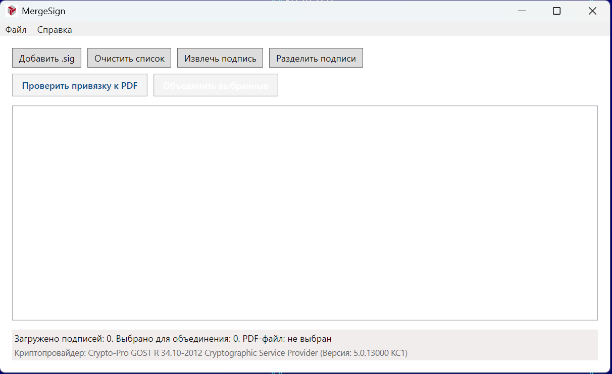

# MergeSign — утилита объединения электронных подписей

MergeSign — оконная утилита для Windows, которая объединяет несколько
отсоединённых электронных подписей (`.sig`, CMS SignedData) одного документа
в один файл. Программа также проверяет привязку подписей к PDF-документу,
позволяет извлекать вложенное содержимое из присоединённых подписей
(`.p7s`/`.sig`) и разделять файл с несколькими подписями на отдельные `.sig`.



## Возможности

- Объединение нескольких отсоединённых `.sig` в один файл подписи.
- Проверка привязки подписей к исходному PDF-документу.
- Извлечение вложенного документа из присоединённой подписи.
- Разделение файла с несколькими подписями на отдельные `.sig`.
- Просмотр сведений о сертификатах подписантов.
- Работа через локально установленный КриптоПро CSP (ГОСТ 2012).

## Требования

- Windows 10/11 x64.
- .NET 8 SDK — для сборки; .NET 8 Desktop Runtime — для запуска. Либо
  готовый автономный `.exe`, не требующий установленного .NET.
- **КриптоПро CSP 5.0 R2+ с поддержкой ГОСТ 2012 — обязательно.**
  Без него объединение подписей, проверка привязки и вычисление ГОСТ-хешей
  недоступны.

## Сборка

Сборка решения:

```
dotnet build MergeSign.sln
```

Запуск — проект `MergeSign.Gui` (WPF).

Публикация одним автономным `.exe`:

```
dotnet publish MergeSign.Gui/MergeSign.Gui.csproj -c Release -r win-x64 --self-contained true -p:PublishSingleFile=true -p:IncludeNativeLibrariesForSelfExtract=true
```

Результат появится в
`MergeSign.Gui/bin/Release/net8.0-windows/win-x64/publish/`.

## Безопасность

MergeSign — это обёртка над Windows CryptoAPI и установленным КриптоПро CSP;
собственных криптографических библиотек и сторонних DLL в поставке нет.
Приложение вызывает `crypt32.dll`/`advapi32.dll` из системы и использует
зарегистрированный провайдер КриптоПро.

- Используйте только актуальные версии КриптоПро CSP.
- Не размещайте сторонние DLL в папке с программой — это может привести
  к подмене загружаемых библиотек.
- Не запускайте приложение из каталогов с недоверенным содержимым.

## Лицензия

Проект распространяется под лицензией MIT. Полный текст — в файле
[LICENSE](LICENSE).

Автор проекта не распространяет КриптоПро CSP и не связан с его
правообладателем. Для работы приложения необходимо самостоятельно установить
и лицензировать КриптоПро CSP в соответствии с условиями правообладателя.
